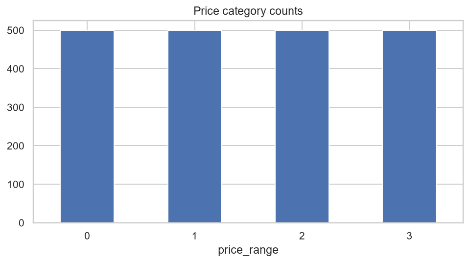
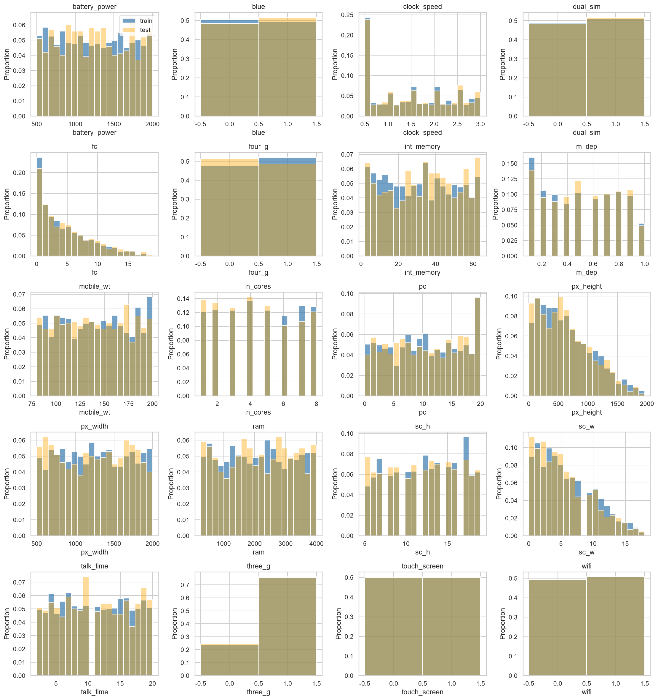
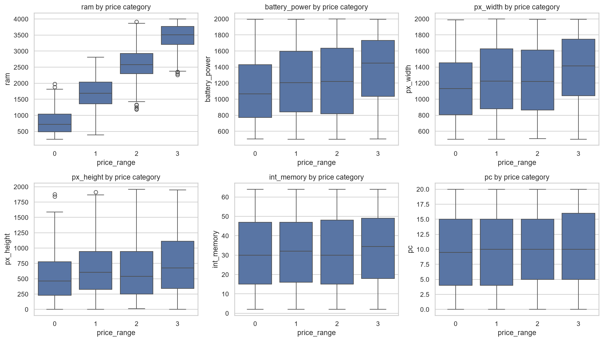
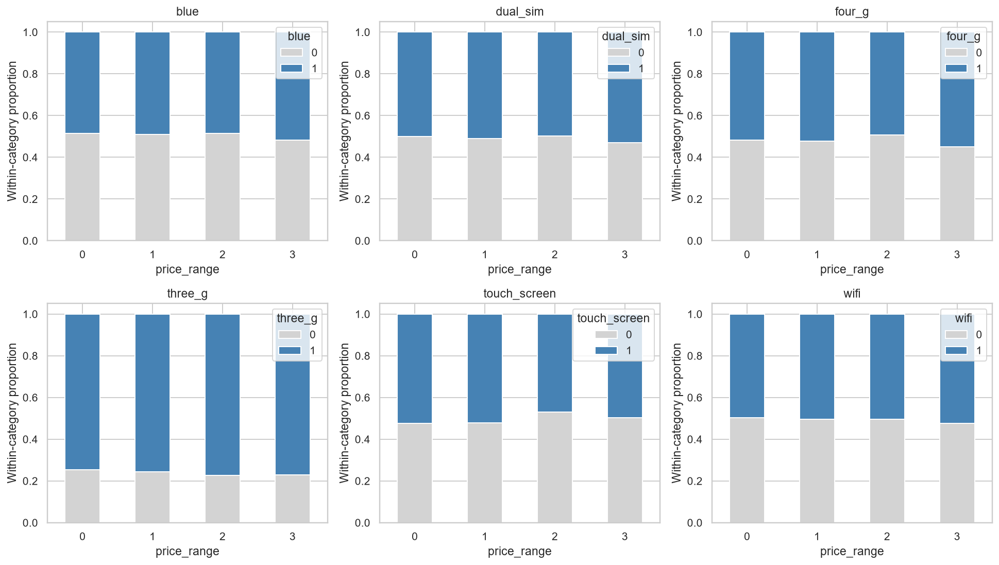
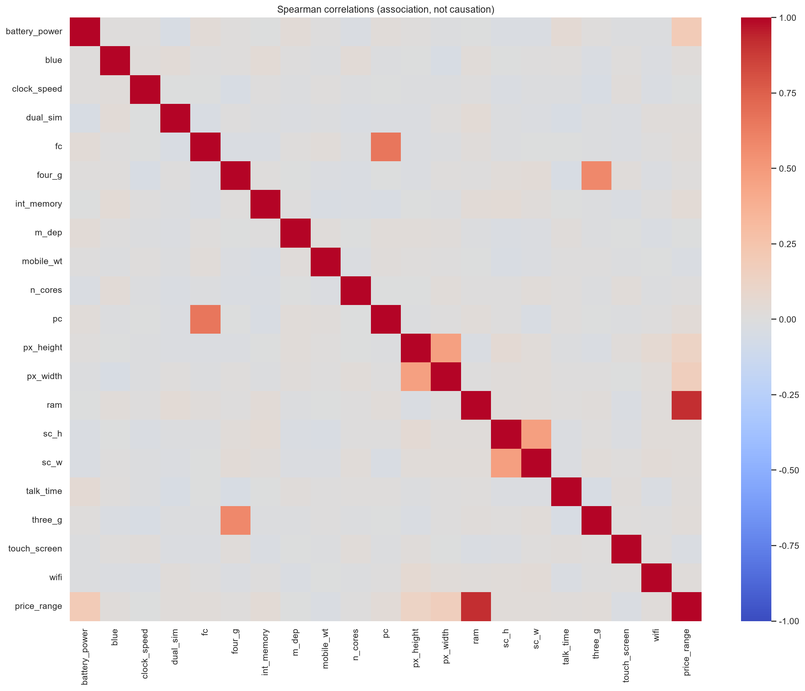

# 스마트폰 가격 등급 EDA 과정과 결과

## 1. 분석 목적과 문제 정의

휴대폰 사양 20개가 가격 등급 `price_range`와 어떤 관계를 가지는지 확인한다.
타깃은 실제 금액이 아닌 0~3의 네 등급이므로 다중 분류 문제로 준비한다.
숫자 순서를 활용한 상관분석은 보조 진단이며 등급 간 가격 차이가 같다는 뜻은 아니다.
등급의 실제 금액 경계와 사양 단위는 CSV에 없으므로 원본 설명을 확인해야 한다.

입력 파일은 `data/mobile_price_category_train.csv`, `data/mobile_price_category_test.csv`이다.
테스트에는 `price_range`가 없으므로 테스트 정확도나 등급별 분포를 계산할 수 없다.
`id`는 결과 식별용으로 보관하고 학습 입력과 상관분석에서 제외한다.

## 2. 구조와 정합성부터 확인

컬럼 일치, 숫자형 변환, 행 개수, 결측·무한값·중복·상수 컬럼을 확인한다.
학습·테스트에서 같은 사양 조합이 반복되는지도 조사한다.

| split | rows | columns | missing_cells | infinite_cells | duplicate_rows | duplicate_features | constant_features |
| --- | --- | --- | --- | --- | --- | --- | --- |
| train | 2000 | 21 | 0 | 0 | 0 | 0 |  |
| test | 1000 | 21 | 0 | 0 | 0 | 0 |  |

- 학습·테스트 공통 사양 조합: 0개.
- 동일 사양인데 타깃이 다른 학습 조합: 0개.
- 테스트 id 결측: 0개, 중복: 0개.

특성에 결측이 있으면 대체값은 이후 학습 폴드에서만 계산한다. 중복은 출처를 확인하고
같은 기기가 검증 양쪽에 들어가지 않도록 처리한다. EDA 코드 자체는 원본을 수정하지 않는다.

## 3. 타깃 균형 확인

| price_range | count | percent |
| --- | --- | --- |
| 0 | 500 | 25.0000 |
| 1 | 500 | 25.0000 |
| 2 | 500 | 25.0000 |
| 3 | 500 | 25.0000 |



등급 불균형은 Accuracy 해석에 영향을 준다. 향후 검증에는 층화 분할과 Macro-F1,
클래스별 Recall, 혼동행렬을 함께 사용한다. 균형이 충분하면 가중치나 오버샘플링부터 추가하지 않는다.

## 4. 값의 의미와 범위 점검

이진 컬럼은 0/1인지, 연속형은 음수·무한값이 있는지, 코어 수는 양의 정수인지 확인한다.
화면 크기·해상도 0은 의심값이다. 카메라 0은 미지원일 수 있어 곧바로 결측으로 바꾸지 않는다.
전면/후면 카메라 비교와 4G/3G 조합은 사양 정의가 필요한 검토 항목이다.
높이·너비는 기기 방향에 따라 달라질 수 있어 대소관계만으로 오류를 단정하지 않는다.

| split | column | severity | reason | count |
| --- | --- | --- | --- | --- |
| test | px_height | review | 화면 크기/해상도 0값 | 2 |
| test | sc_w | review | 화면 크기/해상도 0값 | 112 |
| train | px_height | review | 화면 크기/해상도 0값 | 2 |
| train | sc_w | review | 화면 크기/해상도 0값 | 180 |

행별 위치와 값은 `issues.csv`에 기록한다. CSV 행 번호는 헤더를 포함한 1부터의 번호다.
IQR 1.5배 기준은 **통계적 검토 후보**일 뿐 물리적 오류가 아니다.
IQR 경계는 학습 데이터에서 계산하고 테스트에도 그대로 적용한다.
가격 등급이 높은 정상 고사양 제품을 일괄 제거하면 중요한 신호를 잃을 수 있다.

## 5. 단변량 분포 확인

각 특성의 범위, 중앙값, 비대칭, 극단값, 이진 비율을 확인한다.
학습·테스트 행 수가 달라 히스토그램은 건수가 아닌 비율로 비교한다.



로그 변환·표준화 필요성은 향후 모델에 따라 판단한다. 트리 모델은 일반적으로
표준화가 필수는 아니며 선형 모델·거리 기반 모델은 검토할 필요가 있다.

## 6. 가격 등급과 특성의 관계

학습 데이터만으로 Spearman 순위 상관을 계산하고 등급별 박스플롯·평균·중앙값을 비교한다.
이진 특성은 등급 안에서 0/1 비율을 비교한다. 숫자로 코딩된 범주와 상관이 낮더라도
비선형 관계나 다른 특성과의 상호작용은 있을 수 있다.

| feature | spearman | absolute |
| --- | --- | --- |
| ram | 0.9171 | 0.9171 |
| battery_power | 0.2000 | 0.2000 |
| px_width | 0.1651 | 0.1651 |
| px_height | 0.1319 | 0.1319 |
| int_memory | 0.0443 | 0.0443 |
| pc | 0.0328 | 0.0328 |
| touch_screen | -0.0304 | 0.0304 |
| mobile_wt | -0.0302 | 0.0302 |





상관 순위는 모델의 특성 중요도가 아니며 인과관계를 뜻하지 않는다.
특성끼리의 중복 정보는 아래 행렬에서 확인한다.



## 7. 학습·테스트 분포 차이

| feature | train_mean | test_mean | train_median | test_median | ks_statistic | test_outside_train_range |
| --- | --- | --- | --- | --- | --- | --- |
| int_memory | 32.0465 | 33.6520 | 32.0000 | 34.5000 | 0.0575 | 0 |
| sc_w | 5.7670 | 5.3160 | 5.0000 | 5.0000 | 0.0550 | 0 |
| m_dep | 0.5018 | 0.5175 | 0.5000 | 0.5000 | 0.0440 | 0 |
| n_cores | 4.5205 | 4.3280 | 4.0000 | 4.0000 | 0.0435 | 0 |
| fc | 4.3095 | 4.5930 | 3.0000 | 3.0000 | 0.0380 | 0 |
| four_g | 0.5215 | 0.4870 | 1.0000 | 0.0000 | 0.0345 | 0 |
| px_width | 1251.5155 | 1239.7740 | 1247.0000 | 1250.0000 | 0.0340 | 0 |
| sc_h | 12.3065 | 11.9950 | 12.0000 | 12.0000 | 0.0335 | 0 |

KS 통계량은 두 경험적 누적분포의 최대 차이이며 0에 가까울수록 유사하다.
이진·이산 컬럼에서는 보조적으로 읽고 비율도 확인한다. 평균만 비슷하다고
전체 분포가 같은 것은 아니다. 표본 차이만으로 분포 이동을 확정하지 않는다.
테스트가 학습 최솟값·최댓값 밖에 있는 건수도 별도로 기록한다.
테스트 분석은 적용 가능성 진단에 사용하고, 전처리 학습이나 모델 선택에는 넣지 않는다.

## 8. 모델링으로 이어지는 결정

1. 학습 데이터 내부에서 `stratify=price_range`, 고정 난수로 검증 세트를 먼저 확보한다.
   날짜 컬럼은 없으므로 앞선 Delhi 기후 데이터의 시계열 분할을 그대로 적용하지 않는다.
   동일 기기 그룹이 확인되면 그룹 분할을 우선한다.
2. 검증 타깃을 반복해서 탐색하며 특성을 고르면 평가가 낙관적으로 변한다.
   이 보고서의 전체 학습 데이터 EDA는 탐색용으로 읽고 최종 성능은 독립 검증한다.
3. `id`를 제외한 원래 20개 사양으로 기준 모델을 먼저 만들고 Accuracy/Macro-F1을 비교한다.
4. 화면 픽셀 수(`px_height * px_width`)와 화면 면적(`sc_h * sc_w`)은 후보지만,
   0값 의미부터 확인하고 검증 성능이 개선되는 경우에만 채택한다.
5. 테스트는 정답이 없으므로 최종 예측 CSV만 생성할 수 있다. 이 EDA는 학습을 수행하지 않는다.

## 실행과 산출물

```powershell
uv run python mobile_price_eda.py
uv run python mobile_price_eda.py --self-check
```

실행하면 이 문서(`mobile_price_eda.md`)와 `output/mobile_price_eda`의 표·차트를 갱신한다.
`quality.csv`, `schema.csv`, `describe.csv`, `class_balance.csv`는 기본 구조와 분포,
`issues.csv`, `issue_counts.csv`, `iqr_review.csv`는 정제 검토 목록,
`target_associations.csv`, `class_feature_summary.csv`, `spearman_correlation.csv`는 관계 분석,
`distribution_shift.csv`는 학습·테스트 차이를 담는다.
