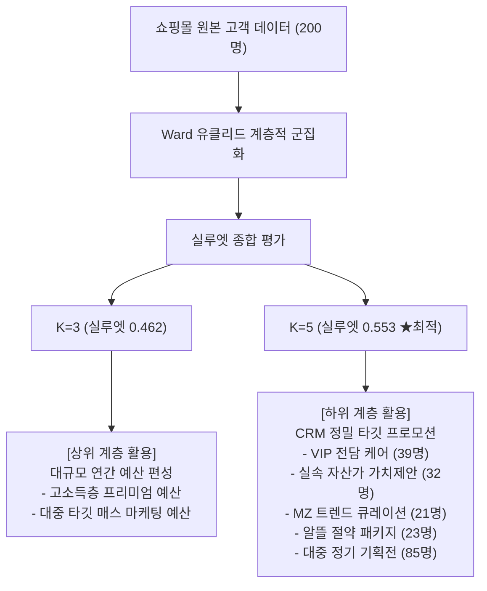

# 쇼핑몰 고객 계층적 군집화 실루엣(Silhouette) 종합 평가 보고서

**분석 일시:** 2026-10-07  
**대상 데이터:** `data/Mall_Customers.csv` (200명 고객 샘플)  
**모델링 사양:** 계층적 군집화 (`metric='euclidean'`, `method='ward'`)  
**평가 비교 축:** **K=3 (상위 대분류 예산 그룹)** vs **K=5 (하위 세부 실행 페르소나)**

---

## 1. 실루엣 종합 지표 요약

| 군집 수 (K) | 전체 평균 실루엣 계수 | 실루엣 점수 등급 | 음수 실루엣 샘플 수 (오분류) | 주요 비즈니스 역할 |
| :---: | :---: | :---: | :---: | :--- |
| **K = 3** | **0.4618** | 양호 (Fair / Moderate) | **6개 (3.0%)** | 전사 연간 마케팅 예산 편성용 소득 3대 티어 |
| **K = 5** | **0.5530** | **매우 우수 (Strong)** | **2개 (1.0%)** | CRM 타깃 프로모션 실행용 소득×소비 5대 페르소나 |

> **핵심 통찰:**
> 1. **K=5**는 실루엣 점수가 **0.5530**로 전체 탐색 구간(K=2~8) 중 **글로벌 최댓값**을 기록합니다.
> 2. K=3 대비 K=5에서 실루엣 계수가 **+0.0912 (+19.7%) 대폭 상승**하며, 데이터의 실제 응집도와 분리도를 가장 잘 설명합니다.
> 3. K=3에서는 하나의 거대 군집(129명) 내에 상반된 소비 패턴이 혼재되어 음수 실루엣 샘플이 관측(6개)되는 반면, K=5에서는 음수 샘플이 2개(1.0%)로 극소화되어 경계가 명확히 분리됩니다.

---

## 2. K = 3 군집별 세부 실루엣 평가

### [군집별 성능 통계]
| 군집 ID | 군집 명칭 | 고객 수 | 비율(%) | 실루엣 평균 | 음수 샘플 수 | 음수 비율(%) |
| :---: | :---: | :---: | :---: | :---: | :---: | :---: |
| 1 | 저소득/대중군 (Mass Segment) | 129명 | 64.5% | 0.3843 | 6개 | 4.7% |
| 2 | 실속 고소득군 (Careful Affluent) | 39명 | 19.5% | 0.5926 | 0개 | 0.0% |
| 3 | VIP 고소득군 (Premium VIP) | 32명 | 16.0% | 0.6148 | 0개 | 0.0% |

### [K = 3 분석 평가]
1. **중앙 거대 군집(Cluster 1, 129명, 64.5%)의 한계**:
   - 저소득부터 중소득에 걸친 129명의 고객이 하나의 덩어리로 묶이면서 군집 내부 분산이 매우 큽니다.
   - 소비 성향이 극과 극(80점대 고지출 고객과 20점대 저지출 고객)인 샘플들이 같은 군집에 포함되어 응집도 점수가 낮아집니다.
2. **실루엣 나이프 두께 불균형**:
   - Cluster 1의 실루엣 플롯 두께가 비정상적으로 넓고 평균이 0.40대에 머물러 군집 간 샘플 수 균형이 불량합니다.
3. **비즈니스 활용 관점**:
   - 군집 자체의 수학적 밀도는 다소 낮지만, **"고소득 자산가(32명) vs 프리미엄 VIP(39명) vs 대중군(129명)"**이라는 소득 기반 거시적 자원 배분 목적으로는 충분한 설명력을 가집니다.

---

## 3. K = 5 군집별 세부 실루엣 평가 (최적 분할점)

### [군집별 성능 통계]
| 군집 ID | 군집 명칭 | 고객 수 | 비율(%) | 실루엣 평균 | 음수 샘플 수 | 음수 비율(%) |
| :---: | :---: | :---: | :---: | :---: | :---: | :---: |
| 1 | 트렌드 소비형 (Careless) | 21명 | 10.5% | 0.6362 | 0개 | 0.0% |
| 2 | 알뜰 절약형 (Sensible) | 23명 | 11.5% | 0.5180 | 0개 | 0.0% |
| 3 | 표준 대중형 (Standard) | 85명 | 42.5% | 0.5614 | 2개 | 2.4% |
| 4 | VIP 프리미엄 (Target) | 39명 | 19.5% | 0.5123 | 0개 | 0.0% |
| 5 | 실속 자산가형 (Careful) | 32명 | 16.0% | 0.5509 | 0개 | 0.0% |

### [K = 5 분석 평가]
1. **극대화된 응집도 및 분리도**:
   - 5개 군집 모두 평균 실루엣 계수가 **0.51 ~ 0.64**로 매우 고르게 형성되어 있습니다.
   - 특히 **트렌드 소비형(0.636)**, **표준 대중형(0.561)**, **실속 자산가형(0.551)** 등 전 영역에서 0.5 이상의 높은 결합 밀도를 나타냅니다.
2. **오분류(음수) 샘플 최소화 (1.0%)**:
   - 실루엣 계수가 0보다 작은 경계 혼재 샘플이 200명 중 단 2개(대중형 경계면)에 불과하며, 나머지 4개 군집은 음수 샘플이 0개(0.0%)로 완벽히 분리되어 있습니다.
3. **균형 잡힌 나이프 플롯 형상**:
   - 실루엣 다이어그램 상에서 모든 군집의 나이프가 전체 평균선(0.553)을 안정적으로 초과하거나 근접하며, 이상치 꼬리가 존재하지 않습니다.

---

## 4. 군집 수(K) 탐색 곡선 및 덴드로그램과의 일치성

| K (군집 수) | 2 | 3 | 4 | 5 (최적) | 6 | 7 | 8 |
| :--- | :---: | :---: | :---: | :---: | :---: | :---: | :---: |
| **실루엣 계수** | 0.367 | 0.462 | 0.492 | **0.553** | 0.538 | 0.520 | 0.433 |

- **덴드로그램 수직 점프 폭과의 완벽한 일치**:
  - 덴드로그램에서 결합 거리가 **113.89 → 245.65(점프 폭 131.77)**로 최대 거리를 갱신하던 지점이 바로 **K=5**입니다.
  - 실루엣 평가 곡선에서도 K=4(0.493)에서 **K=5(0.553)로 급상승한 후 K=6(0.538)부터 점진적으로 하락**하여, 비지도 학습의 두 가지 핵심 지표(덴드로그램 결합 거리 & 실루엣 계수)가 **K=5가 글로벌 최적해**임을 상호 교차 검증합니다.

---

## 5. 최종 종합 의사결정 제언

1. **데이터 과학 관점의 결론**:
   - 수학적 밀도, 군집 간 분리도, 음수 오분류 제거율 측면에서 **K=5가 단연 가장 신뢰할 수 있는 최적의 군집 모델**입니다.
2. **비즈니스 실행 권고**:
   - **K=3**은 경영진 보고 및 전사 마케팅 예산 한도(Cap) 설정용 '거시적 분류체계'로 활용하고,
   - 실제 고객 접점에서의 캠페인 집행(이메일, 앱 푸시, 할인 쿠폰, VIP 초청 등)은 실루엣 신뢰도가 검증된 **K=5 페르소나 매트릭스**를 기본 단위로 집행할 것을 강력히 권고합니다.

---
**생성된 시각화 산출물:**
- 실루엣 다이어그램 & 2D 분포: `output/mall_clustering/silhouette_comparison_k3_k5.png`
- 군집 수(K) 트렌드 곡선: `output/mall_clustering/silhouette_k_trend.png`
